# Multitool-Sammlung

Sammlung meiner Multitools

Stand: 01.11.2026 · Datenquelle: `Multitools.xlsx` · Eintraege: 39

## Kennzahlen

| Kennzahl | Wert |
| --- | --- |
| Tools total | 39 |
| Bilder total | 77 |
| Erscheinungsjahr von / bis | 1.995 - 2.026 |
| Summe Kaufpreis | 1.001,00 € |
| Durchschnitt Kaufpreis | 125,12 € |

### Verteilung: Zustand Multitool

| Zustand Multitool | Anzahl |
| --- | ---: |
| Neuwertig | 23 |
| Sehr gut | 14 |
| Gut | 2 |

### Nach Hersteller

| Hersteller | Tools | Kaufpreis |
| --- | ---: | ---: |
| Leatherman | 39 | 1.001,00 € |

## Alle Tools

| Tool | Hersteller | Erscheinungsjahr | Zustand Multitool | Kaufpreis | Bilder |
| --- | --- | ---: | --- | ---: | ---: |
| [Leatherman - ARC](objekte/leatherman-arc.md) | Leatherman | 2.023 | Gut | 45,00 € | 2 |
| [Leatherman - ARC](objekte/leatherman-arc-m014.md) | Leatherman | 2.023 | Neuwertig | 280,00 € | 2 |
| [Leatherman - ARC Obsidian](objekte/leatherman-arc-obsidian.md) | Leatherman | - | Neuwertig | 349,00 € | 2 |
| [Leatherman - Blast](objekte/leatherman-blast.md) | Leatherman | 2.005 | Sehr gut | - | 2 |
| [Leatherman - Bond](objekte/leatherman-bond.md) | Leatherman | - | Sehr gut | - | 2 |
| [Leatherman - C33x](objekte/leatherman-c33x.md) | Leatherman | - | Neuwertig | - | 2 |
| [Leatherman - Charge](objekte/leatherman-charge.md) | Leatherman | 2.004 | Sehr gut | - | 2 |
| [Leatherman - Charge Titanium](objekte/leatherman-charge-titanium.md) | Leatherman | - | Sehr gut | - | 2 |
| [Leatherman - Core](objekte/leatherman-core.md) | Leatherman | 2.008 | Neuwertig | - | 2 |
| [Leatherman - Crunch](objekte/leatherman-crunch.md) | Leatherman | 1.999 | Neuwertig | 125,00 € | 2 |
| [Leatherman - Free K2](objekte/leatherman-free-k2.md) | Leatherman | 2.026 | Neuwertig | - | 2 |
| [Leatherman - Free T4](objekte/leatherman-free-t4.md) | Leatherman | - | Neuwertig | - | 2 |
| [Leatherman - Free T4](objekte/leatherman-free-t4-m027.md) | Leatherman | - | Neuwertig | - | 2 |
| [Leatherman - Micra](objekte/leatherman-micra.md) | Leatherman | - | Neuwertig | 17,00 € | 2 |
| [Leatherman - Micra](objekte/leatherman-micra-m021.md) | Leatherman | - | Neuwertig | 17,00 € | 2 |
| [Leatherman - Minitool](objekte/leatherman-minitool.md) | Leatherman | 1.995 | Neuwertig | 8,00 € | 2 |
| [Leatherman - Raptor](objekte/leatherman-raptor.md) | Leatherman | - | Neuwertig | - | 2 |
| [Leatherman - Rebar](objekte/leatherman-rebar.md) | Leatherman | - | Sehr gut | - | 2 |
| [Leatherman - Rev](objekte/leatherman-rev.md) | Leatherman | - | Neuwertig | - | 2 |
| [Leatherman - Rev](objekte/leatherman-rev-m018.md) | Leatherman | - | Neuwertig | - | 2 |
| [Leatherman - S2](objekte/leatherman-s2.md) | Leatherman | - | Sehr gut | - | 1 |
| [Leatherman - Sideclip](objekte/leatherman-sideclip.md) | Leatherman | - | Sehr gut | - | 2 |
| [Leatherman - Signal](objekte/leatherman-signal.md) | Leatherman | - | Neuwertig | - | 2 |
| [Leatherman - Skeletool CX](objekte/leatherman-skeletool-cx.md) | Leatherman | 2.026 | Neuwertig | - | 2 |
| [Leatherman - Skeletool KB](objekte/leatherman-skeletool-kb.md) | Leatherman | 2.026 | Sehr gut | - | 2 |
| [Leatherman - Squirt P4](objekte/leatherman-squirt-p4.md) | Leatherman | 2.026 | Gut | - | 2 |
| [Leatherman - Supertool](objekte/leatherman-supertool.md) | Leatherman | 1.996 | Neuwertig | - | 2 |
| [Leatherman - Supertool](objekte/leatherman-supertool-m011.md) | Leatherman | 1.999 | Neuwertig | - | 2 |
| [Leatherman - Supertool 200](objekte/leatherman-supertool-200.md) | Leatherman | 2.002 | Neuwertig | - | 2 |
| [Leatherman - Supertool 300](objekte/leatherman-supertool-300.md) | Leatherman | 2.018 | Neuwertig | - | 2 |
| [Leatherman - Surge](objekte/leatherman-surge.md) | Leatherman | - | Neuwertig | - | 2 |
| [Leatherman - Surge](objekte/leatherman-surge-m022.md) | Leatherman | - | Sehr gut | - | 2 |
| [Leatherman - Tool](objekte/leatherman-tool.md) | Leatherman | 1.995 | Sehr gut | - | 2 |
| [Leatherman - Tread](objekte/leatherman-tread.md) | Leatherman | - | Neuwertig | 160,00 € | 2 |
| [Leatherman - Wave](objekte/leatherman-wave.md) | Leatherman | - | Sehr gut | - | 2 |
| [Leatherman - Wave](objekte/leatherman-wave-m034.md) | Leatherman | - | Sehr gut | - | 2 |
| [Leatherman - Wave](objekte/leatherman-wave-m035.md) | Leatherman | - | Sehr gut | - | 2 |
| [Leatherman - Wave +](objekte/leatherman-wave-m033.md) | Leatherman | - | Sehr gut | - | 2 |
| [Leatherman - Wingman](objekte/leatherman-wingman.md) | Leatherman | - | Neuwertig | - | 2 |

## Leatherman

### [Leatherman - ARC](objekte/leatherman-arc.md)

[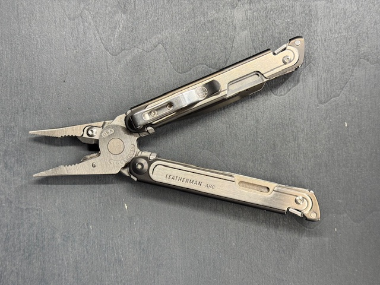](objekte/leatherman-arc.md)

*Leatherman - ARC*

### [Leatherman - ARC](objekte/leatherman-arc-m014.md)

[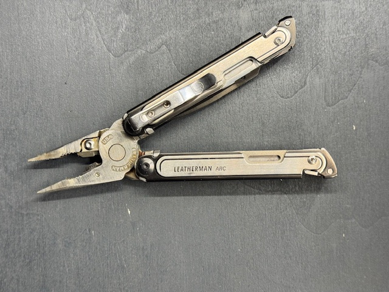](objekte/leatherman-arc-m014.md)

*Leatherman - ARC*

### [Leatherman - ARC Obsidian](objekte/leatherman-arc-obsidian.md)

[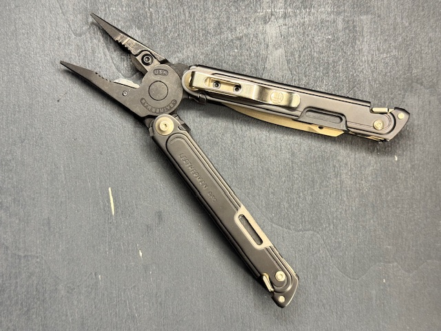](objekte/leatherman-arc-obsidian.md)

*Leatherman - ARC Obsidian*

### [Leatherman - Blast](objekte/leatherman-blast.md)

[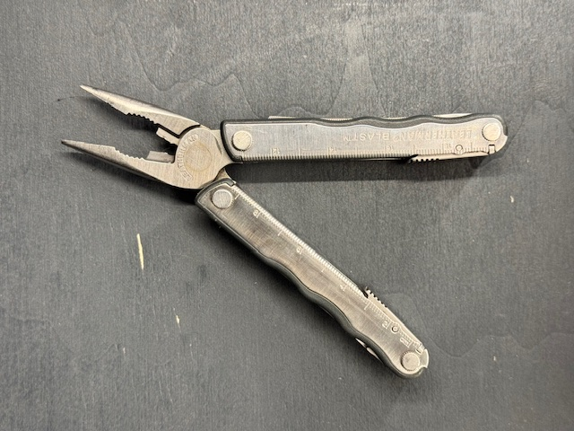](objekte/leatherman-blast.md)

*Leatherman - Blast*

### [Leatherman - Bond](objekte/leatherman-bond.md)

[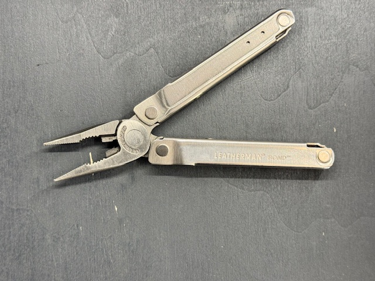](objekte/leatherman-bond.md)

*Leatherman - Bond*

### [Leatherman - C33x](objekte/leatherman-c33x.md)

[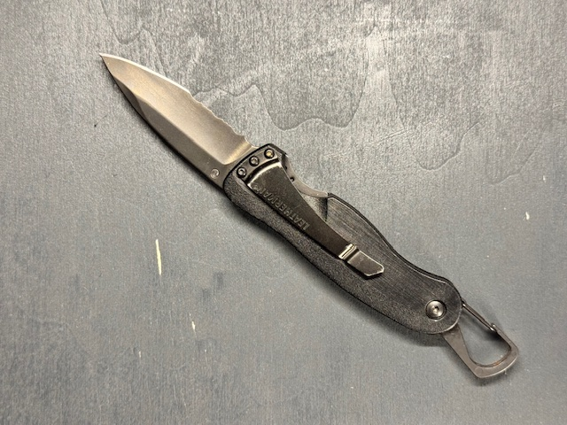](objekte/leatherman-c33x.md)

*Leatherman - C33x*

### [Leatherman - Charge](objekte/leatherman-charge.md)

[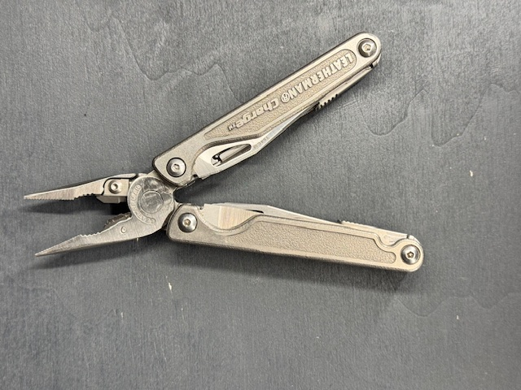](objekte/leatherman-charge.md)

*Leatherman - Charge*

### [Leatherman - Charge Titanium](objekte/leatherman-charge-titanium.md)

[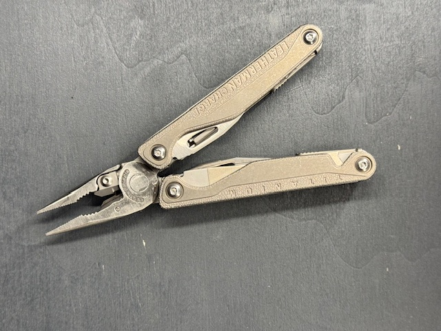](objekte/leatherman-charge-titanium.md)

*Leatherman - Charge Titanium*

S30V Klinge

### [Leatherman - Core](objekte/leatherman-core.md)

[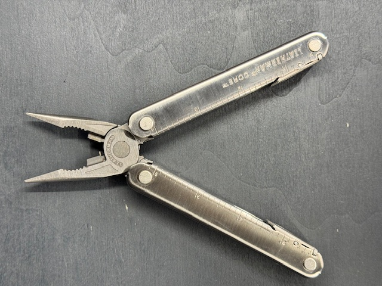](objekte/leatherman-core.md)

*Leatherman - Core*

### [Leatherman - Crunch](objekte/leatherman-crunch.md)

[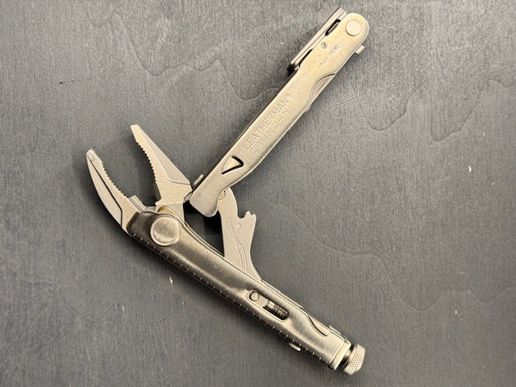](objekte/leatherman-crunch.md)

*Leatherman - Crunch*

### [Leatherman - Free K2](objekte/leatherman-free-k2.md)

[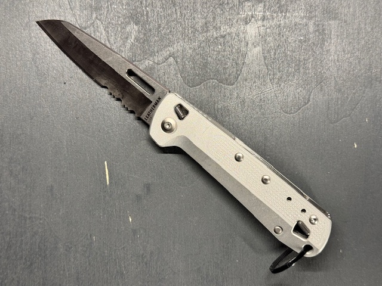](objekte/leatherman-free-k2.md)

*Leatherman - Free K2*

### [Leatherman - Free T4](objekte/leatherman-free-t4.md)

[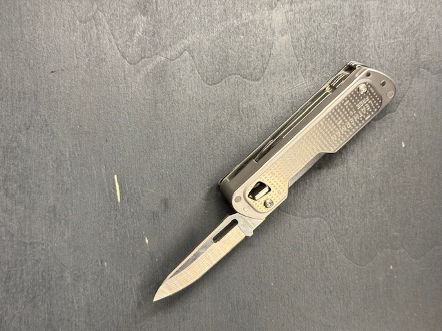](objekte/leatherman-free-t4.md)

*Leatherman - Free T4*

### [Leatherman - Free T4](objekte/leatherman-free-t4-m027.md)

[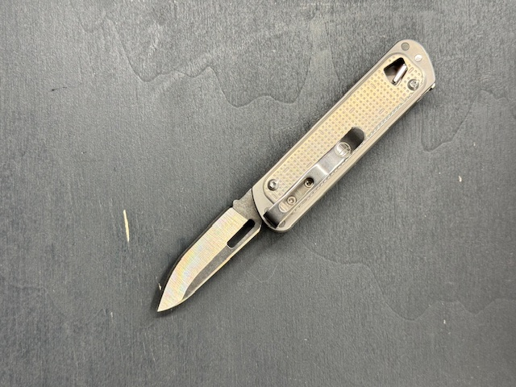](objekte/leatherman-free-t4-m027.md)

*Leatherman - Free T4*

### [Leatherman - Micra](objekte/leatherman-micra.md)

[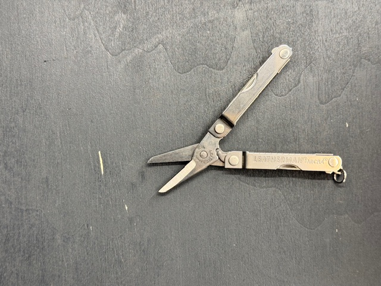](objekte/leatherman-micra.md)

*Leatherman - Micra*

### [Leatherman - Micra](objekte/leatherman-micra-m021.md)

[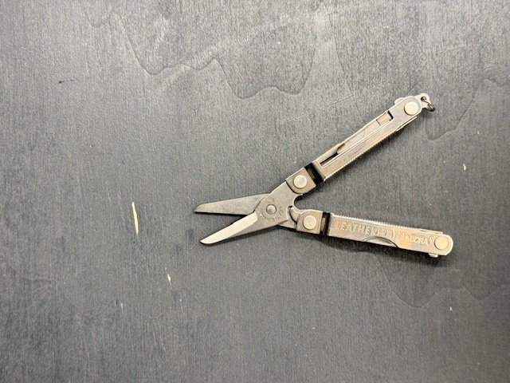](objekte/leatherman-micra-m021.md)

*Leatherman - Micra*

### [Leatherman - Minitool](objekte/leatherman-minitool.md)

[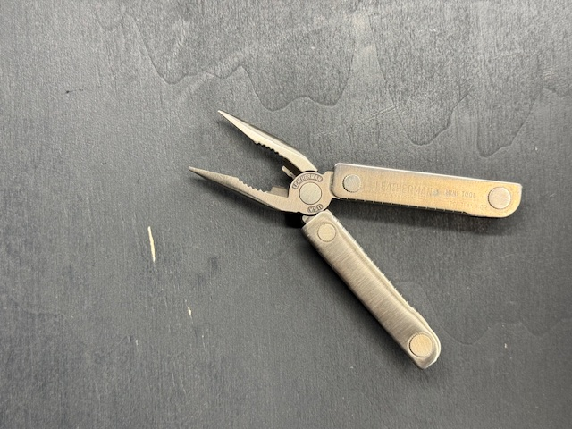](objekte/leatherman-minitool.md)

*Leatherman - Minitool*

### [Leatherman - Raptor](objekte/leatherman-raptor.md)

[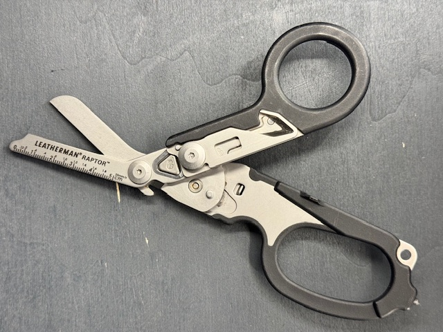](objekte/leatherman-raptor.md)

*Leatherman - Raptor*

### [Leatherman - Rebar](objekte/leatherman-rebar.md)

[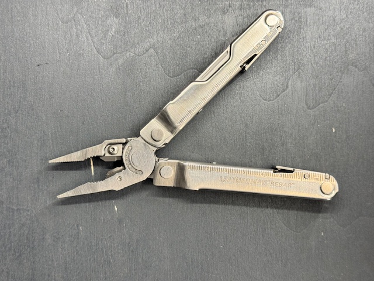](objekte/leatherman-rebar.md)

*Leatherman - Rebar*

### [Leatherman - Rev](objekte/leatherman-rev.md)

[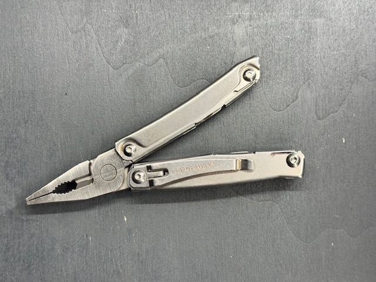](objekte/leatherman-rev.md)

*Leatherman - Rev*

### [Leatherman - Rev](objekte/leatherman-rev-m018.md)

[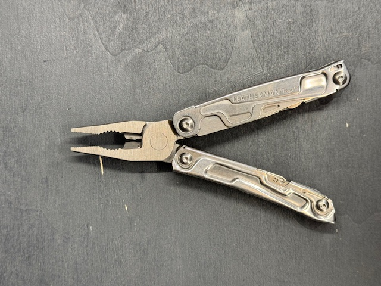](objekte/leatherman-rev-m018.md)

*Leatherman - Rev*

### [Leatherman - S2](objekte/leatherman-s2.md)

[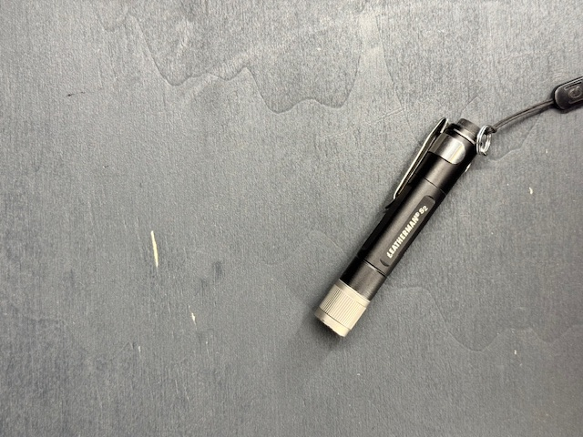](objekte/leatherman-s2.md)

*Leatherman - S2*

### [Leatherman - Sideclip](objekte/leatherman-sideclip.md)

[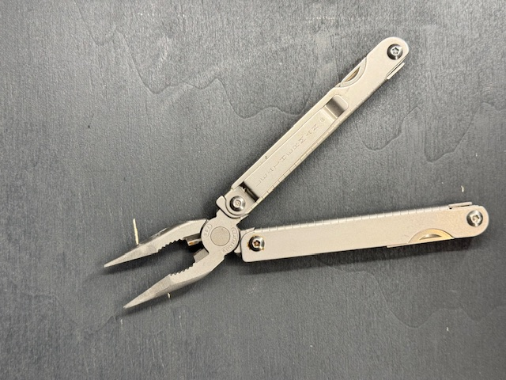](objekte/leatherman-sideclip.md)

*Leatherman - Sideclip*

### [Leatherman - Signal](objekte/leatherman-signal.md)

[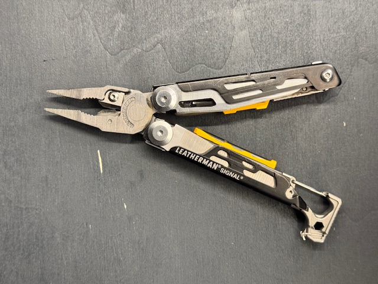](objekte/leatherman-signal.md)

*Leatherman - Signal*

### [Leatherman - Skeletool CX](objekte/leatherman-skeletool-cx.md)

[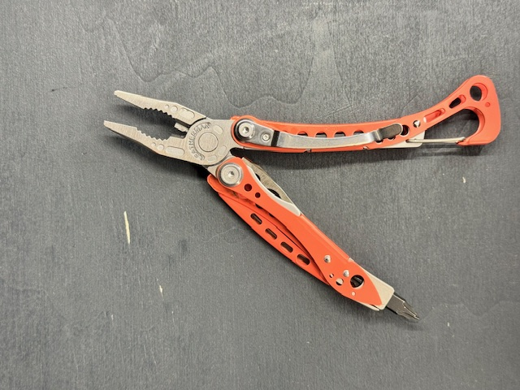](objekte/leatherman-skeletool-cx.md)

*Leatherman - Skeletool CX*

### [Leatherman - Skeletool KB](objekte/leatherman-skeletool-kb.md)

[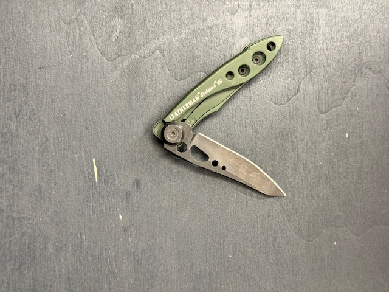](objekte/leatherman-skeletool-kb.md)

*Leatherman - Skeletool KB*

### [Leatherman - Squirt P4](objekte/leatherman-squirt-p4.md)

[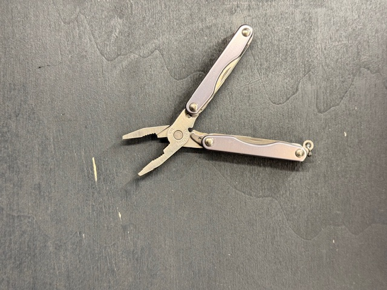](objekte/leatherman-squirt-p4.md)

*Leatherman - Squirt P4*

### [Leatherman - Supertool](objekte/leatherman-supertool.md)

[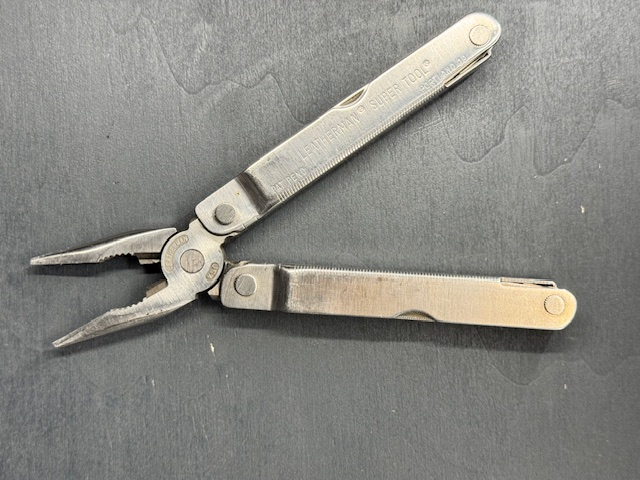](objekte/leatherman-supertool.md)

*Leatherman - Supertool*

### [Leatherman - Supertool](objekte/leatherman-supertool-m011.md)

[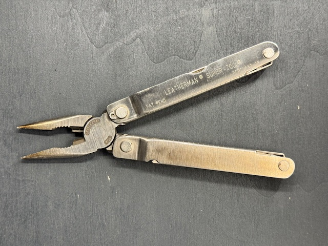](objekte/leatherman-supertool-m011.md)

*Leatherman - Supertool*

### [Leatherman - Supertool 200](objekte/leatherman-supertool-200.md)

[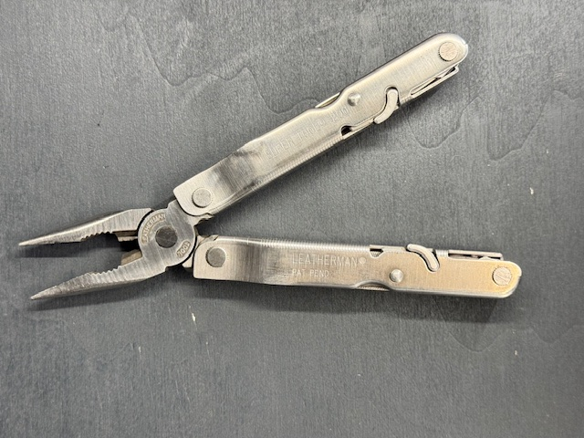](objekte/leatherman-supertool-200.md)

*Leatherman - Supertool 200*

### [Leatherman - Supertool 300](objekte/leatherman-supertool-300.md)

[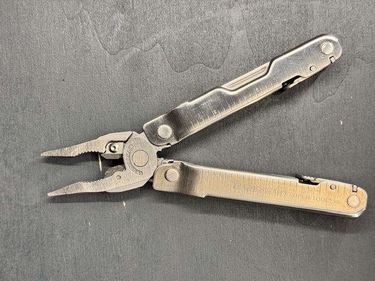](objekte/leatherman-supertool-300.md)

*Leatherman - Supertool 300*

### [Leatherman - Surge](objekte/leatherman-surge.md)

[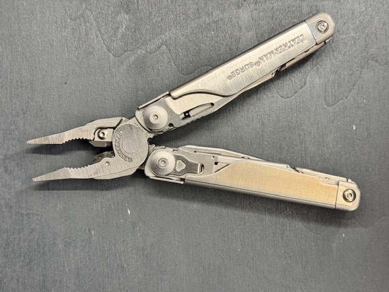](objekte/leatherman-surge.md)

*Leatherman - Surge*

### [Leatherman - Surge](objekte/leatherman-surge-m022.md)

[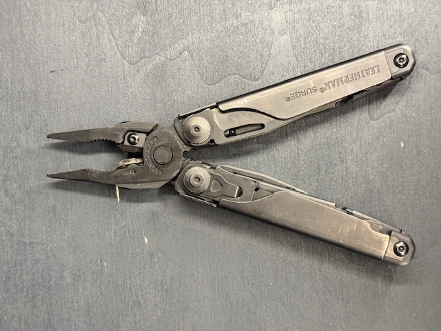](objekte/leatherman-surge-m022.md)

*Leatherman - Surge*

### [Leatherman - Tool](objekte/leatherman-tool.md)

[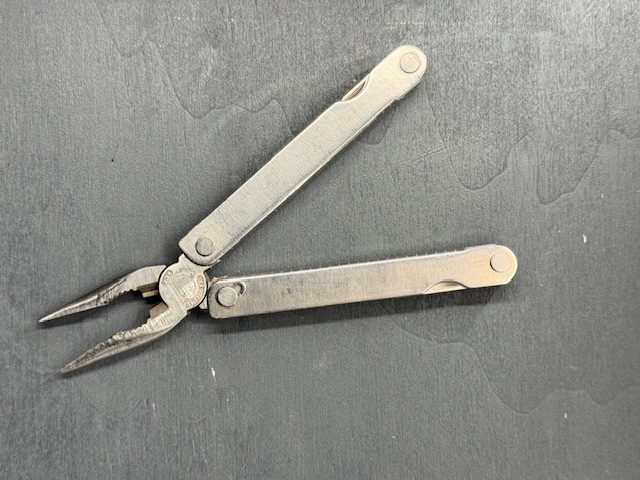](objekte/leatherman-tool.md)

*Leatherman - Tool*

### [Leatherman - Tread](objekte/leatherman-tread.md)

[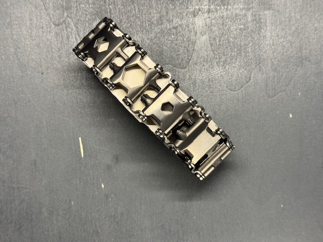](objekte/leatherman-tread.md)

*Leatherman - Tread*

### [Leatherman - Wave](objekte/leatherman-wave.md)

[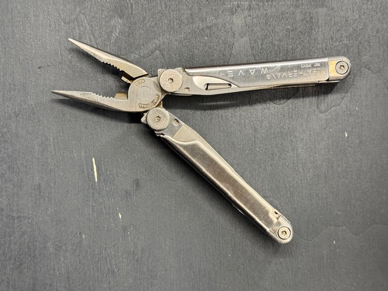](objekte/leatherman-wave.md)

*Leatherman - Wave*

### [Leatherman - Wave](objekte/leatherman-wave-m034.md)

[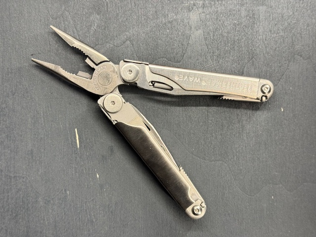](objekte/leatherman-wave-m034.md)

*Leatherman - Wave*

### [Leatherman - Wave](objekte/leatherman-wave-m035.md)

[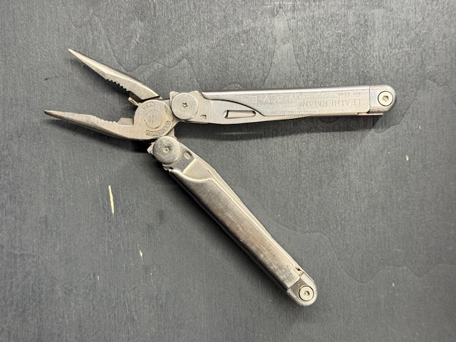](objekte/leatherman-wave-m035.md)

*Leatherman - Wave*

### [Leatherman - Wave +](objekte/leatherman-wave-m033.md)

[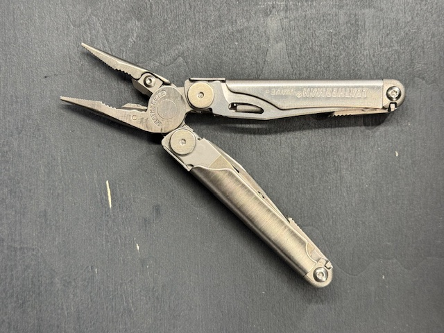](objekte/leatherman-wave-m033.md)

*Leatherman - Wave +*

### [Leatherman - Wingman](objekte/leatherman-wingman.md)

[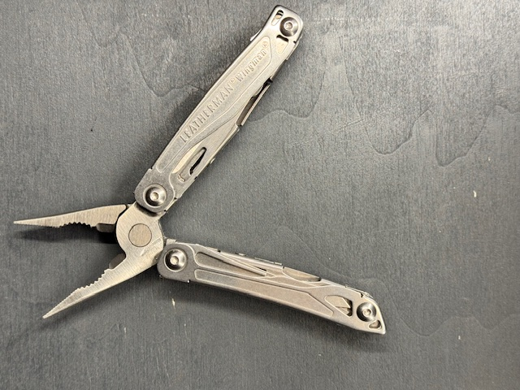](objekte/leatherman-wingman.md)

*Leatherman - Wingman*

---

Nicht von Hand bearbeiten - diese Datei wird bei jedem Build ueberschrieben.