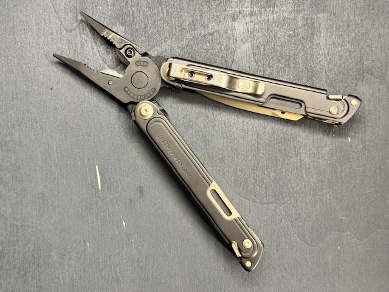
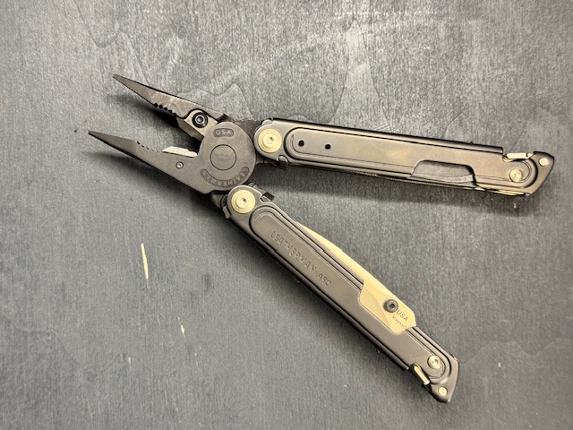

[Zurueck zur Uebersicht](../README.md)

# Leatherman - ARC Obsidian

*Leatherman - ARC Obsidian*

## Eckdaten

| Eigenschaft | Wert |
| --- | --- |
| Hersteller | Leatherman |
| Name | ARC Obsidian |

## Zustand

| Eigenschaft | Wert |
| --- | --- |
| Zustand Multitool | Neuwertig |

## Erwerb

| Eigenschaft | Wert |
| --- | --- |
| Kaufjahr | 01.01.2023 |
| Kaufpreis | 349,00 € |
| Bezugsquelle | Leatherman.com |

## Bilder

**Bild 1 von 2 - ARC Obsidian**

**Bild 2 von 2 - ARC Obsidian**

---

Automatisch generiert am 01.11.2026 aus `Multitools.xlsx` (Datensatz M039). Aenderungen bitte in der Arbeitsmappe vornehmen, nicht hier.