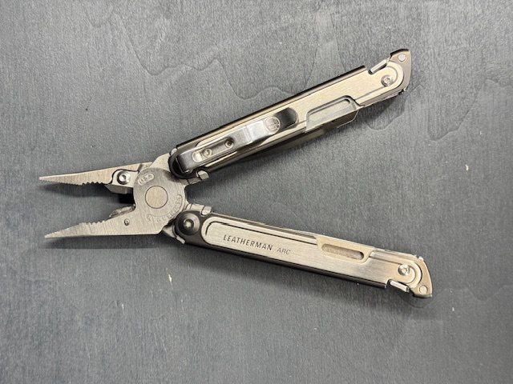
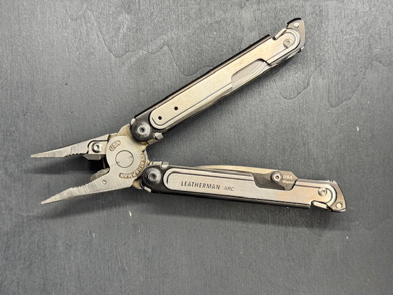

[Zurueck zur Uebersicht](../README.md)

# Leatherman - ARC

*Leatherman - ARC*

## Eckdaten

| Eigenschaft | Wert |
| --- | --- |
| Hersteller | Leatherman |
| Name | ARC |
| Erscheinungsjahr | 2.023 |

## Zustand

| Eigenschaft | Wert |
| --- | --- |
| Zustand Multitool | Gut |

## Erwerb

| Eigenschaft | Wert |
| --- | --- |
| Kaufjahr | 01.01.2025 |
| Kaufpreis | 45,00 € |
| Bezugsquelle | Kleinanzeigen |

## Bilder

**Bild 1 von 2 - ARC**

**Bild 2 von 2 - ARC**

---

Automatisch generiert am 01.11.2026 aus `Multitools.xlsx` (Datensatz M013). Aenderungen bitte in der Arbeitsmappe vornehmen, nicht hier.