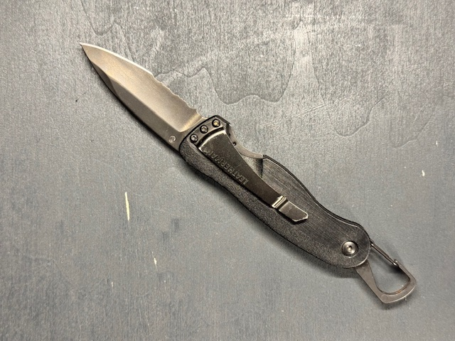
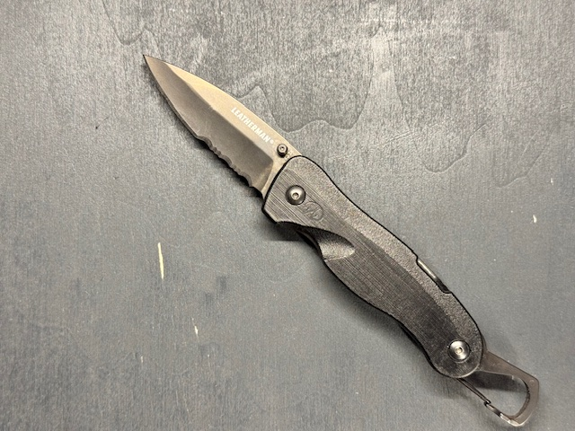

[Zurueck zur Uebersicht](../README.md)

# Leatherman - C33x

*Leatherman - C33x*

## Eckdaten

| Eigenschaft | Wert |
| --- | --- |
| Hersteller | Leatherman |
| Name | C33x |

## Zustand

| Eigenschaft | Wert |
| --- | --- |
| Zustand Multitool | Neuwertig |

## Erwerb

| Eigenschaft | Wert |
| --- | --- |
| Kaufjahr | 01.01.2026 |
| Bezugsquelle | Ebay |

## Bilder

**Bild 1 von 2 - C33x**

**Bild 2 von 2 - C33x**

---

Automatisch generiert am 01.11.2026 aus `Multitools.xlsx` (Datensatz M037). Aenderungen bitte in der Arbeitsmappe vornehmen, nicht hier.