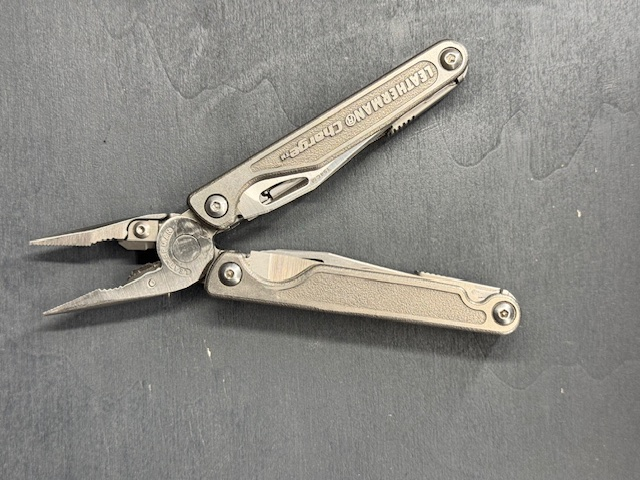
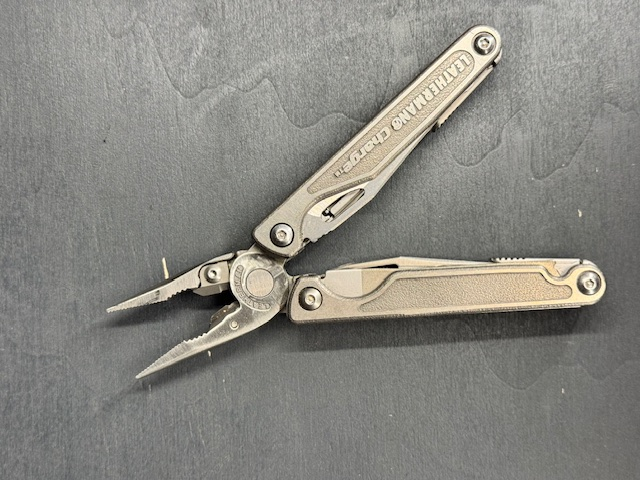

[Zurueck zur Uebersicht](../README.md)

# Leatherman - Charge

*Leatherman - Charge*

## Eckdaten

| Eigenschaft | Wert |
| --- | --- |
| Hersteller | Leatherman |
| Name | Charge |
| Erscheinungsjahr | 2.004 |

## Zustand

| Eigenschaft | Wert |
| --- | --- |
| Zustand Multitool | Sehr gut |

## Bilder

**Bild 1 von 2 - Charge**

**Bild 2 von 2 - Charge**

---

Automatisch generiert am 01.11.2026 aus `Multitools.xlsx` (Datensatz M005). Aenderungen bitte in der Arbeitsmappe vornehmen, nicht hier.