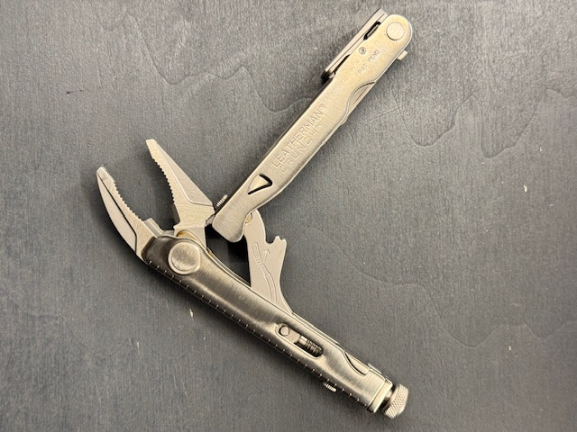
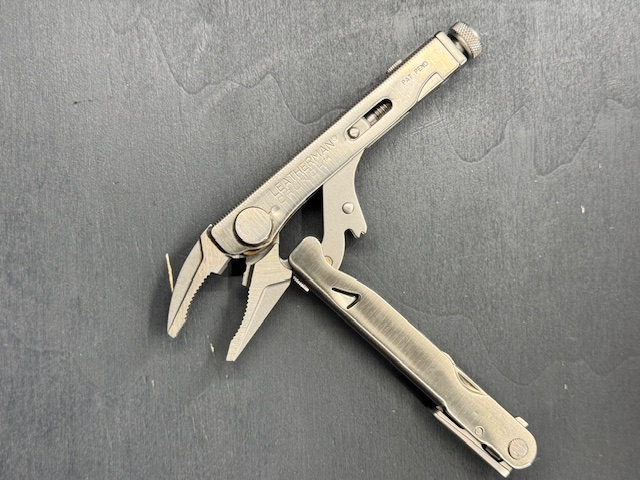

[Zurueck zur Uebersicht](../README.md)

# Leatherman - Crunch

*Leatherman - Crunch*

## Eckdaten

| Eigenschaft | Wert |
| --- | --- |
| Hersteller | Leatherman |
| Name | Crunch |
| Erscheinungsjahr | 1.999 |

## Zustand

| Eigenschaft | Wert |
| --- | --- |
| Zustand Multitool | Neuwertig |

## Erwerb

| Eigenschaft | Wert |
| --- | --- |
| Kaufpreis | 125,00 € |
| Bezugsquelle | Ebay |

## Bilder

**Bild 1 von 2 - Crunch**

**Bild 2 von 2 - Crunch**

---

Automatisch generiert am 01.11.2026 aus `Multitools.xlsx` (Datensatz M016). Aenderungen bitte in der Arbeitsmappe vornehmen, nicht hier.