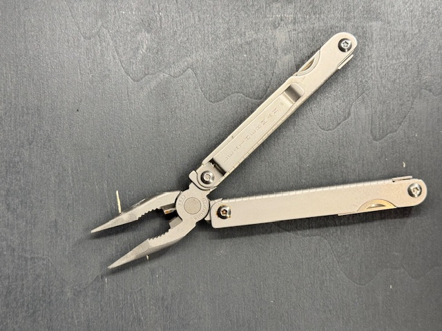
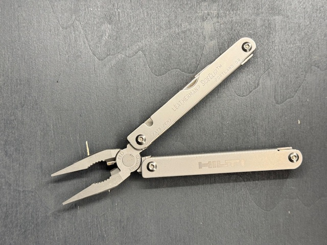

[Zurueck zur Uebersicht](../README.md)

# Leatherman - Sideclip

*Leatherman - Sideclip*

## Eckdaten

| Eigenschaft | Wert |
| --- | --- |
| Hersteller | Leatherman |
| Name | Sideclip |

## Zustand

| Eigenschaft | Wert |
| --- | --- |
| Zustand Multitool | Sehr gut |

## Erwerb

| Eigenschaft | Wert |
| --- | --- |
| Kaufjahr | 01.01.2026 |

## Notizen

Aufdruck "Hilti"

## Bilder

**Bild 1 von 2 - Sideclip**

**Bild 2 von 2 - Sideclip**

---

Automatisch generiert am 01.11.2026 aus `Multitools.xlsx` (Datensatz M004). Aenderungen bitte in der Arbeitsmappe vornehmen, nicht hier.