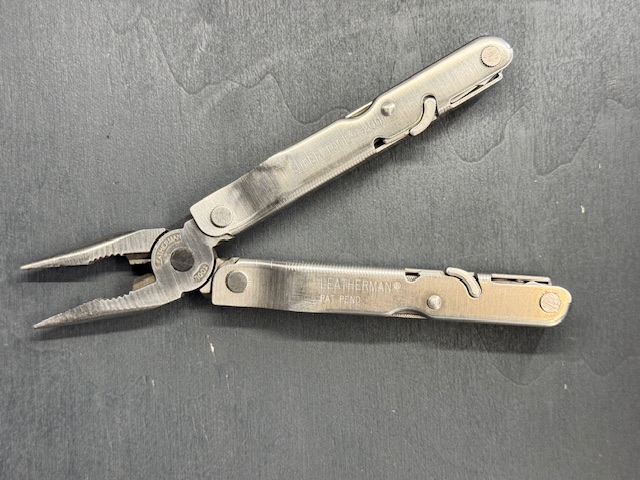
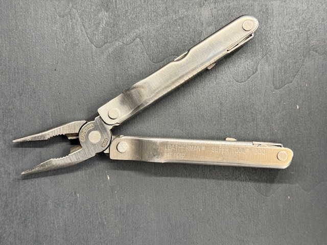

[Zurueck zur Uebersicht](../README.md)

# Leatherman - Supertool 200

*Leatherman - Supertool 200*

## Eckdaten

| Eigenschaft | Wert |
| --- | --- |
| Hersteller | Leatherman |
| Name | Supertool 200 |
| Erscheinungsjahr | 2.002 |

## Zustand

| Eigenschaft | Wert |
| --- | --- |
| Zustand Multitool | Neuwertig |

## Bilder

**Bild 1 von 2 - Supertool 200**

**Bild 2 von 2 - Supertool 200**

---

Automatisch generiert am 01.11.2026 aus `Multitools.xlsx` (Datensatz M012). Aenderungen bitte in der Arbeitsmappe vornehmen, nicht hier.