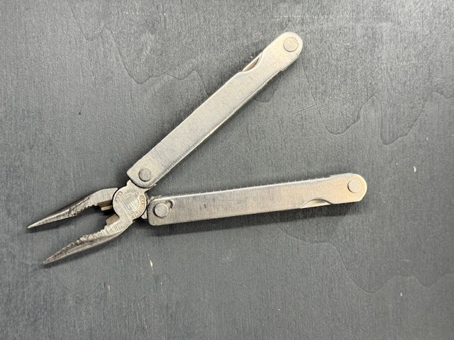
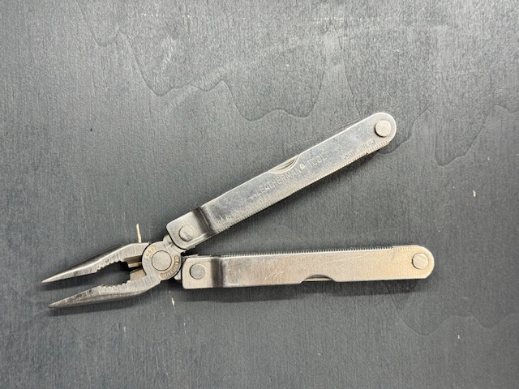

[Zurueck zur Uebersicht](../README.md)

# Leatherman - Tool

*Leatherman - Tool*

## Eckdaten

| Eigenschaft | Wert |
| --- | --- |
| Hersteller | Leatherman |
| Name | Tool |
| Erscheinungsjahr | 1.995 |

## Zustand

| Eigenschaft | Wert |
| --- | --- |
| Zustand Multitool | Sehr gut |

## Notizen

signiert

## Bilder

**Bild 1 von 2 - Tool**

**Bild 2 von 2 - Tool**

---

Automatisch generiert am 01.11.2026 aus `Multitools.xlsx` (Datensatz M003). Aenderungen bitte in der Arbeitsmappe vornehmen, nicht hier.