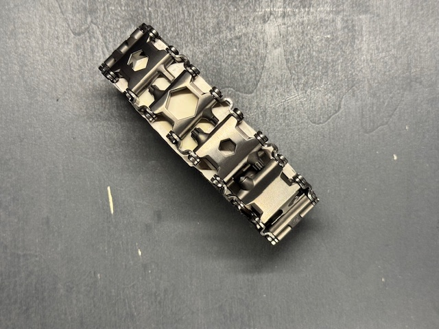
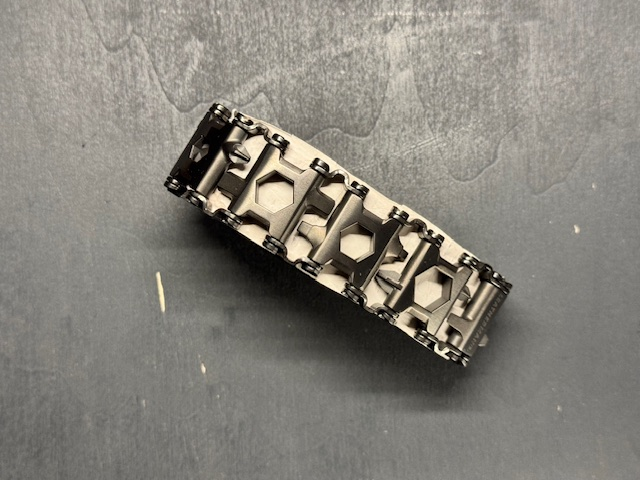

[Zurueck zur Uebersicht](../README.md)

# Leatherman - Tread

*Leatherman - Tread*

## Eckdaten

| Eigenschaft | Wert |
| --- | --- |
| Hersteller | Leatherman |
| Name | Tread |

## Zustand

| Eigenschaft | Wert |
| --- | --- |
| Zustand Multitool | Neuwertig |

## Erwerb

| Eigenschaft | Wert |
| --- | --- |
| Kaufjahr | 01.01.2024 |
| Kaufpreis | 160,00 € |
| Bezugsquelle | Barcelona |

## Bilder

**Bild 1 von 2 - Tread**

**Bild 2 von 2 - Tread**

---

Automatisch generiert am 01.11.2026 aus `Multitools.xlsx` (Datensatz M038). Aenderungen bitte in der Arbeitsmappe vornehmen, nicht hier.