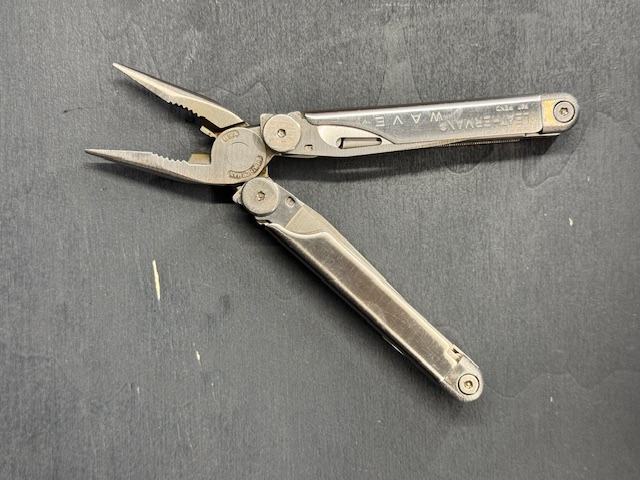
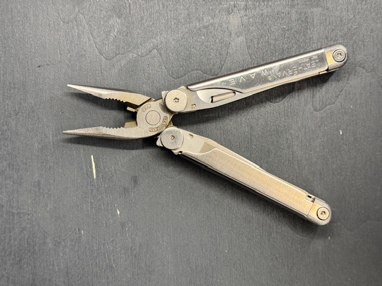

[Zurueck zur Uebersicht](../README.md)

# Leatherman - Wave

*Leatherman - Wave*

## Eckdaten

| Eigenschaft | Wert |
| --- | --- |
| Hersteller | Leatherman |
| Name | Wave |

## Zustand

| Eigenschaft | Wert |
| --- | --- |
| Zustand Multitool | Sehr gut |

## Bilder

**Bild 1 von 2 - Wave**

**Bild 2 von 2 - Wave**

---

Automatisch generiert am 01.11.2026 aus `Multitools.xlsx` (Datensatz M032). Aenderungen bitte in der Arbeitsmappe vornehmen, nicht hier.