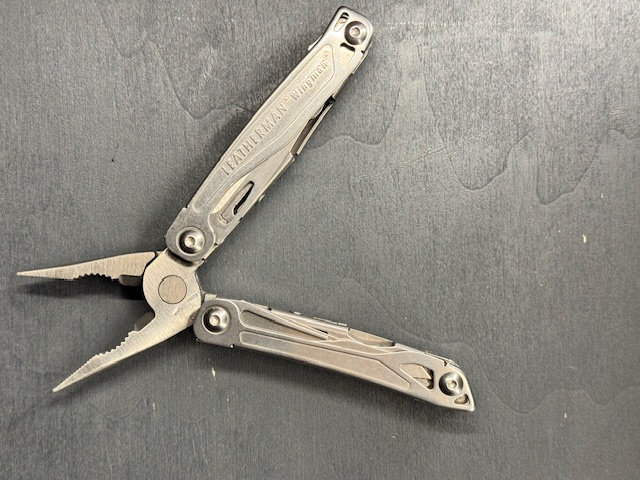
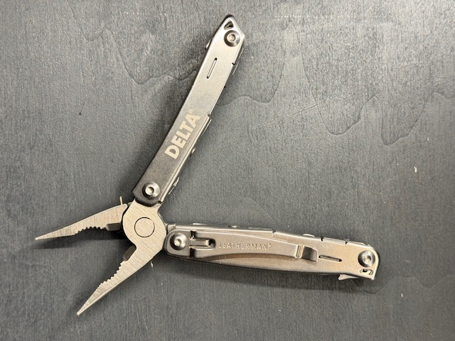

[Zurueck zur Uebersicht](../README.md)

# Leatherman - Wingman

*Leatherman - Wingman*

## Eckdaten

| Eigenschaft | Wert |
| --- | --- |
| Hersteller | Leatherman |
| Name | Wingman |

## Zustand

| Eigenschaft | Wert |
| --- | --- |
| Zustand Multitool | Neuwertig |

## Notizen

Aufdruck "Delta"

## Bilder

**Bild 1 von 2 - Wingman**

**Bild 2 von 2 - Wingman**

---

Automatisch generiert am 01.11.2026 aus `Multitools.xlsx` (Datensatz M001). Aenderungen bitte in der Arbeitsmappe vornehmen, nicht hier.